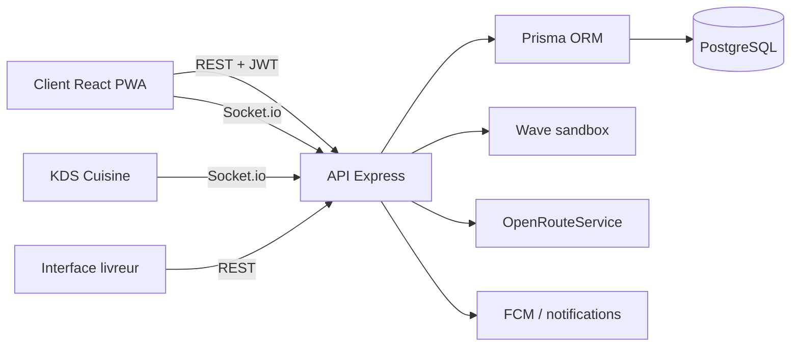
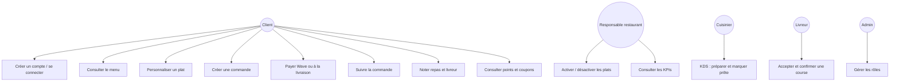
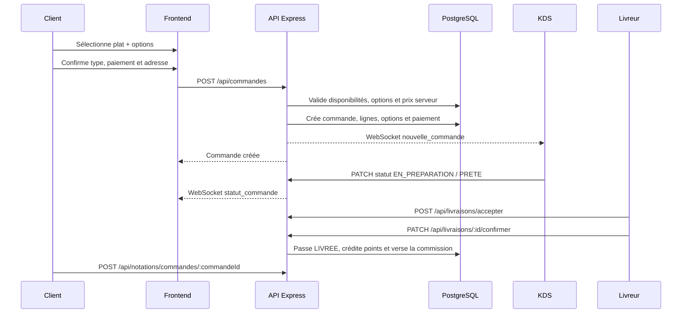

# Documentation technique — RestoClik Ziguinchor

## Architecture

## Cas d’utilisation

## Séquence de commande

## Règles métier principales

- Le prix d'une commande est toujours recalculé depuis PostgreSQL.
- Une ligne peut contenir plusieurs options ; les options obligatoires et exclusives sont contrôlées côté serveur.
- Un coupon appartient à un seul client, expire sous 30 jours et ne peut être utilisé qu'une fois.
- Les points sont crédités au statut `LIVREE` : 1 point par tranche de 100 FCFA.
- La commission par défaut est de 8 % et reste en séquestre jusqu'à confirmation de livraison.
- L'interface client est responsive et dispose d'un Service Worker via Vite PWA.

## Lancement local

Voir les fichiers `resto-api/README.md` et `resto-frontend/README.md`. Les secrets doivent rester dans `.env` et ne doivent pas être commités.
